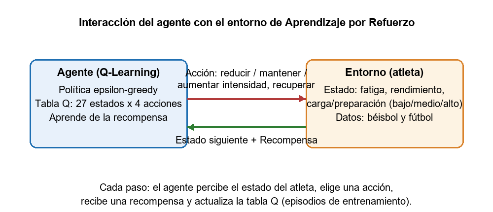
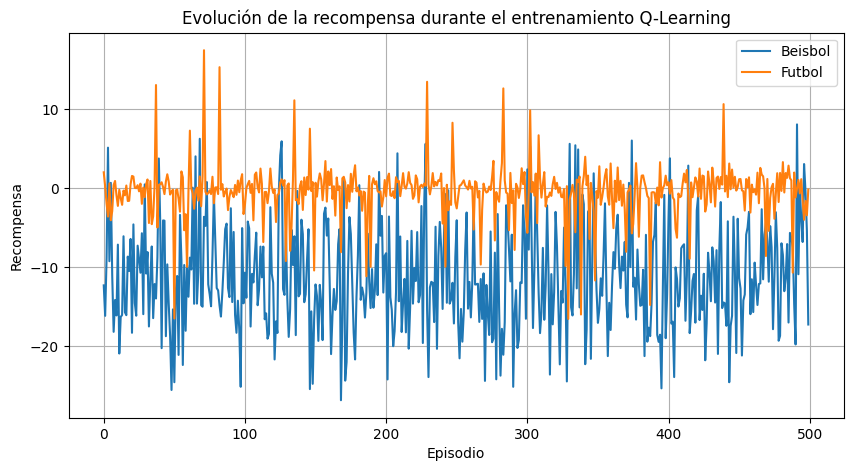

**Universidad de Oriente**

**Facultad de Ingeniería en Telecomunicaciones, Informática y Biomédica**

**Aplicación del Aprendizaje por Refuerzo en la Gestión y Optimización del Rendimiento Deportivo en Béisbol y Fútbol**

<u>Integrantes:</u>

Alejandro Manuel Tamayo Morales

Francis Alejandro Liranza Liranza

Rolando Javier Vila Rodríguez

**CARRERA INGENIERÍA INFORMÁTICA**

**2026-2027**

<u>Definición del conjunto de Datos:</u>

Para el desarrollo del proyecto se utilizaron dos conjuntos de datos internacionales: el Athlete Injury and Performance Dataset, disponible en la plataforma Kaggle, y el conjunto de datos SoccerMon, utilizado para el análisis de información relacionada con el fútbol.

El conjunto de datos Athlete Injury and Performance Dataset contiene variables relacionadas con las características físicas de los atletas, la intensidad del entrenamiento, las horas de entrenamiento semanales, los días de recuperación, la fatiga, el rendimiento deportivo y los indicadores de riesgo de lesión. En el proyecto, estos datos se utilizaron como base para representar diferentes estados relacionados con el rendimiento y la condición física de los atletas de béisbol.

El conjunto de datos SoccerMon contiene información deportiva de jugadores de fútbol, incluyendo variables relacionadas con la fatiga, la preparación del jugador, la carga diaria de entrenamiento, el rendimiento en los partidos y los indicadores de lesión. Estos datos se procesaron y relacionaron mediante la fecha y el jugador para construir los estados utilizados en el entorno de Aprendizaje por Refuerzo.

Ambos conjuntos de datos se procesaron para definir estados y recompensas que permitieran entrenar el algoritmo Q-Learning. El modelo se desarrolló con un carácter experimental, por lo que los resultados representan una simulación de la selección de acciones relacionadas con la gestión del entrenamiento deportivo.

<u>Enlaces de acceso a los conjuntos de datos y recursos del proyecto:</u>

* **Athlete Injury and Performance Dataset (béisbol), Kaggle:** [https://www.kaggle.com/datasets/ziya07/athlete-injury-and-performance-dataset](https://www.kaggle.com/datasets/ziya07/athlete-injury-and-performance-dataset)
* **SoccerMon Dataset (fútbol), Zenodo:** [https://zenodo.org/records/10033832](https://zenodo.org/records/10033832)
* **Notebook de entrenamiento (Google Colab):** [https://colab.research.google.com/drive/1fWz5IFy-Vba0ngmd4NKluw8_AJ6hVNoq](https://colab.research.google.com/drive/1fWz5IFy-Vba0ngmd4NKluw8_AJ6hVNoq)
* **Repositorio del proyecto (GitHub):** [https://github.com/RolandoJV/Entrenamiento.Refuerzo.ElevatorPitch](https://github.com/RolandoJV/Entrenamiento.Refuerzo.ElevatorPitch)

El archivo de béisbol utilizado en el código es `collegiate_athlete_injury_dataset.csv` (Kaggle). El conjunto SoccerMon se descarga de Zenodo y se organiza en las carpetas `wellness` (fatigue.csv, readiness.csv), `training-load` (daily_load.csv), `game-performance` (game-performance.csv) e `injury` (injury.csv), que son las rutas que lee el notebook.

<u>Descripción de las variables del conjunto de datos:</u>

El conjunto de datos de béisbol contiene variables relacionadas con las características físicas de los atletas, la carga de entrenamiento, la recuperación, el rendimiento deportivo y el riesgo de lesiones. Por su parte, el conjunto de datos SoccerMon contiene información relacionada con la fatiga, la preparación física, la carga diaria de entrenamiento, el rendimiento y los indicadores de lesión de los jugadores de fútbol.

Estas variables se procesaron para representar diferentes situaciones en las que puede encontrarse un deportista dentro del entorno de Aprendizaje por Refuerzo.

Entre las variables más importantes utilizadas en el proyecto se encuentran:

* Nivel de fatiga (Fatigue\_Score): permite identificar el estado de cansancio del atleta.
* Puntuación de rendimiento (Performance\_Score): representa el nivel de rendimiento deportivo registrado en el conjunto de datos de béisbol.
* Puntuación de equilibrio de carga (Load\_Balance\_Score): permite analizar el equilibrio de la carga de entrenamiento del atleta.
* Indicador de lesión (Injury\_Indicator): señala la presencia de un indicador relacionado con lesiones.
* Puntuación de riesgo de lesión del ligamento cruzado anterior (ACL\_Risk\_Score): representa un indicador relacionado con el riesgo de lesión en el conjunto de datos de béisbol.
* Intensidad del entrenamiento (Training\_Intensity): indica el nivel de intensidad de las actividades realizadas por el atleta.
* Días de recuperación semanales (Recovery\_Days\_Per\_Week): representa la cantidad de días destinados a la recuperación del atleta.

En el conjunto de datos SoccerMon se utilizan variables relacionadas con la fatiga, el nivel de preparación del jugador, la carga diaria de entrenamiento, el rendimiento en los partidos y los indicadores de lesión. Estos datos se procesaron y relacionaron mediante la fecha y el jugador para construir los estados utilizados en el entorno de Aprendizaje por Refuerzo.

Para construir los estados del entorno, el código utiliza principalmente tres variables en cada deporte. En el caso del béisbol, se emplean el nivel de fatiga, el rendimiento y el equilibrio de carga. En el caso del fútbol, se utilizan la fatiga, la preparación del jugador y la carga diaria de entrenamiento. Estas variables se discretizan en tres niveles: bajo, medio y alto, lo que permite representar 27 estados posibles.

El sistema utiliza esta información para seleccionar acciones relacionadas con la gestión de la intensidad del entrenamiento y la recuperación. Las acciones disponibles son reducir la intensidad, mantener la intensidad, aumentar la intensidad y aumentar la recuperación. La selección de estas acciones se realiza mediante el algoritmo Q-Learning, considerando el estado físico y las condiciones del deportista.

<u>Planteamiento del problema:</u>

En el béisbol y el fútbol, la gestión adecuada de la carga de entrenamiento es importante para mantener el rendimiento de los atletas y reducir el riesgo de fatiga excesiva y lesiones. Los deportistas están expuestos a diferentes niveles de esfuerzo físico y necesidades de recuperación, que pueden variar según las características de cada disciplina deportiva.

Una dificultad en la gestión deportiva consiste en determinar qué ajuste debe realizarse en el entrenamiento cuando un atleta presenta un nivel elevado de fatiga, una disminución de su rendimiento o un riesgo mayor de lesión. Las decisiones pueden incluir mantener la intensidad del entrenamiento, reducirla, aumentarla o incrementar el tiempo de recuperación.

Por este motivo, se plantea el desarrollo de un sistema basado en Aprendizaje por Refuerzo mediante el algoritmo Q-Learning, que permita analizar diferentes estados de los atletas de béisbol y fútbol y seleccionar acciones relacionadas con la gestión de su entrenamiento. El sistema utiliza variables como la fatiga, el rendimiento, la carga de entrenamiento, la preparación física y los indicadores de lesión.

El problema que se pretende abordar se puede expresar de la siguiente manera:

¿Cómo utilizar el algoritmo Q-Learning para seleccionar acciones relacionadas con la intensidad del entrenamiento y la recuperación de los atletas de béisbol y fútbol, considerando su estado físico y deportivo?

La propuesta tiene un carácter experimental y de apoyo al análisis de la gestión deportiva. Los resultados generados por el sistema no sustituyen la valoración de los entrenadores, preparadores físicos ni profesionales médicos.

<u>Objetivo general:</u>

Desarrollar una propuesta experimental basada en el algoritmo de Aprendizaje por Refuerzo Q-Learning para apoyar la gestión de la carga de entrenamiento y la recuperación de atletas de béisbol y fútbol, mediante el análisis de variables relacionadas con la fatiga, el rendimiento deportivo, la intensidad del entrenamiento y el riesgo de lesiones, con el propósito de seleccionar acciones relacionadas con la intensidad del entrenamiento y la recuperación de los deportistas.

<u>Objetivos específicos:</u>

1. Analizar las variables relacionadas con la carga de entrenamiento, la fatiga, la recuperación, el rendimiento deportivo y el riesgo de lesiones en atletas de béisbol y fútbol.

2. Definir los estados, las acciones y las recompensas que formarán parte del entorno de Aprendizaje por Refuerzo, teniendo en cuenta las características de los datos utilizados en ambos deportes.

3. Diseñar un modelo experimental basado en Q-Learning que permita estudiar la selección de acciones relacionadas con la intensidad del entrenamiento y la recuperación de los atletas.

4. Implementar un prototipo capaz de procesar los datos disponibles y entrenar el modelo Q-Learning para seleccionar acciones relacionadas con la gestión de la carga de entrenamiento.

5. Evaluar el comportamiento del prototipo mediante el análisis de las recompensas obtenidas durante el entrenamiento y de las acciones seleccionadas en diferentes estados de fatiga, rendimiento y recuperación.

6. Proponer una herramienta experimental de apoyo al análisis de la gestión deportiva, cuyos resultados puedan servir como referencia para entrenadores y preparadores físicos, sin sustituir su valoración profesional.

<u>Alcance y limitaciones del proyecto:</u>

**Alcance**

El proyecto está orientado al diseño y desarrollo de un prototipo experimental basado en Aprendizaje por Refuerzo, específicamente mediante el algoritmo Q-Learning, para apoyar el análisis de la gestión de la carga de entrenamiento y la recuperación de atletas de béisbol y fútbol.

El sistema utiliza variables relacionadas con la fatiga, el rendimiento deportivo, la carga de entrenamiento, la preparación física y los indicadores de riesgo de lesiones. A partir de estas variables, se construye un entorno en el que el agente selecciona acciones relacionadas con la intensidad del entrenamiento y la recuperación.

Las acciones disponibles son reducir la intensidad, mantener la intensidad, aumentar la intensidad y aumentar la recuperación. El prototipo permite realizar simulaciones y analizar las recompensas obtenidas y las acciones seleccionadas por el agente durante el entrenamiento del modelo Q-Learning.

Los resultados sirven para estudiar la aplicación del Aprendizaje por Refuerzo como herramienta experimental de apoyo al análisis de la gestión deportiva.

Limitaciones

* Los conjuntos de datos utilizados son internacionales y no representan necesariamente las características de todos los atletas de béisbol y fútbol.
* Los conjuntos de datos no contienen información específica y detallada de todas las situaciones propias de cada deporte, por lo que se realiza una adaptación experimental de sus variables para construir el entorno.
* El modelo utiliza una representación discretizada de los estados, por lo que no contempla todas las posibles condiciones físicas y deportivas de los atletas.
* El sistema no sustituye la experiencia de los entrenadores, preparadores físicos ni profesionales médicos.
* Las recompensas y acciones generadas corresponden a resultados experimentales y no deben interpretarse como diagnósticos médicos ni como instrucciones definitivas para la planificación deportiva.
* La calidad de los resultados depende de la información disponible, la definición de los estados, las acciones y las recompensas, así como de la configuración del algoritmo Q-Learning y del entorno de aprendizaje.

**Justificación:**

La gestión adecuada del entrenamiento deportivo es un aspecto importante para mantener el rendimiento de los atletas y reducir situaciones relacionadas con la fatiga excesiva y las lesiones. En el béisbol y el fútbol, los deportistas están sometidos a diferentes cargas físicas, exigencias competitivas y necesidades de recuperación. Por esta razón, el análisis de la información disponible puede contribuir al desarrollo de herramientas que apoyen el estudio de la planificación del entrenamiento.

La aplicación de técnicas de Inteligencia Artificial, específicamente del Aprendizaje por Refuerzo, permite estudiar la selección de acciones a partir del estado actual de un atleta y de las recompensas obtenidas. En este proyecto, se utiliza esta técnica para experimentar con acciones relacionadas con la intensidad del entrenamiento y la recuperación de los deportistas de béisbol y fútbol.

Se utiliza el algoritmo Q-Learning porque permite aprender una función de valor que relaciona los estados del entorno con las acciones que puede ejecutar el agente. Esto facilita la representación de situaciones deportivas, como un atleta con un nivel elevado de fatiga o con una carga de entrenamiento determinada, y el análisis de las recompensas obtenidas por las acciones seleccionadas dentro del entorno experimental.

Otra razón para utilizar Q-Learning es que permite desarrollar un prototipo mediante la definición de estados, acciones y recompensas, sin necesitar inicialmente un modelo complejo de la dinámica física del atleta. Esto resulta apropiado para una propuesta académica que estudia la aplicación del Aprendizaje por Refuerzo utilizando conjuntos de datos internacionales relacionados con el béisbol y el fútbol.

El proyecto permite explorar el uso de la Inteligencia Artificial como herramienta experimental para el análisis de la gestión deportiva. Sus resultados sirven como referencia para estudiar cómo los datos relacionados con la fatiga, el rendimiento, la carga de entrenamiento y la recuperación pueden incorporarse a un sistema basado en Q-Learning.

La propuesta no pretende sustituir el criterio de los entrenadores, preparadores físicos o profesionales médicos, sino demostrar el uso de un sistema basado en Aprendizaje por Refuerzo para seleccionar acciones dentro de un entorno controlado y experimental.

<u>¿Por qué Aprendizaje por Refuerzo y no otra técnica?</u>

Es una pregunta válida, porque existen varias alternativas de Inteligencia Artificial que podrían aplicarse a datos deportivos. A continuación se explica por qué se eligió el Aprendizaje por Refuerzo, y dentro de él el algoritmo Q-Learning, en lugar de otras opciones:

* **Aprendizaje supervisado (clasificación o regresión):** esta técnica necesita ejemplos etiquetados, es decir, datos que indiquen cuál era la "respuesta correcta". Los conjuntos de datos utilizados solo miden variables como fatiga, rendimiento o carga, pero no contienen la decisión que debió tomar el entrenador en cada situación (reducir o aumentar la intensidad, por ejemplo). Sin etiquetas de ese tipo, no existe un objetivo de aprendizaje supervisado posible. El Aprendizaje por Refuerzo, en cambio, no necesita etiquetas: aprende a partir de una señal de recompensa.
* **Sistemas basados en reglas o umbrales fijos:** consistiría en programar reglas del tipo "si la fatiga es alta, reducir la intensidad". Si bien es simple, estas reglas las define una persona antes de ver los datos, no se adaptan ni aprenden de la experiencia, y cubren mal la combinación de 27 estados posibles con sus distintos niveles de fatiga, rendimiento y carga.
* **Modelos de regresión u optimización clásica:** predicen valores numéricos, pero no toman decisiones secuenciales considerando que la acción elegida afecta el estado futuro del atleta. Además, requerirían una ecuación matemática de la "dinámica física" del deportista, la cual no está disponible en los datasets.
* **Aprendizaje por Refuerzo (Q-Learning):** el problema encaja de forma natural en este marco porque existe un **agente** que decide, un **entorno** (el estado del atleta), **acciones** (ajustes de intensidad y recuperación) y una **recompensa** que resume el objetivo deseado (mayor rendimiento con menor fatiga y menor riesgo de lesión). El agente aprende por interacción, equilibrando exploración y explotación, sin necesidad de un modelo previo de la dinámica del cuerpo humano.

Respecto a por qué Q-Learning y no una variante más compleja (como Deep Q-Network o políticas basadas en redes neuronales): el espacio del problema es pequeño y discreto (27 estados y 4 acciones), por lo que una tabla Q es suficiente, entrenable con pocos datos y **interpretable** (se puede leer qué acción prefiere el agente en cada estado). Esto lo hace adecuado para una propuesta académica experimental como la presentada.

**Modelo del entorno de Aprendizaje por Refuerzo**

Para desarrollar el sistema propuesto, se definió un entorno de Aprendizaje por Refuerzo en el que un agente interactúa con diferentes situaciones relacionadas con el estado físico y deportivo de los atletas de béisbol y fútbol.

El agente recibe información sobre el estado del atleta, selecciona una acción relacionada con la gestión de la intensidad del entrenamiento y la recuperación, y obtiene una recompensa según las condiciones del deportista y la acción seleccionada. Este proceso se repite durante los episodios de entrenamiento para que el algoritmo Q-Learning aprenda a seleccionar acciones a partir de la experiencia obtenida.

**Estados**

Los estados representan las condiciones en las que se encuentra el atleta en un momento determinado. En el proyecto, los estados se construyen mediante la discretización de tres variables principales para cada deporte.

En el caso del béisbol, se utilizan las siguientes variables:

* Nivel de fatiga (Fatigue\_Score).
* Puntuación de rendimiento (Performance\_Score).
* Puntuación de equilibrio de carga (Load\_Balance\_Score).

En el caso del fútbol, se utilizan las siguientes variables:

* Nivel de fatiga.
* Nivel de preparación del jugador (Readiness).
* Carga diaria de entrenamiento (Daily Load).

Cada variable se divide en tres niveles: bajo, medio y alto. La combinación de estos niveles permite representar un total de 27 estados posibles dentro del entorno de Aprendizaje por Refuerzo.

**Acciones**

Las acciones representan las decisiones que el agente puede seleccionar según el estado del deportista. En el modelo se definieron las siguientes cuatro acciones:

1. Reducir la intensidad del entrenamiento.
2. Mantener la intensidad del entrenamiento.
3. Aumentar la intensidad del entrenamiento.
4. Aumentar la recuperación.

Estas acciones permiten estudiar diferentes respuestas ante los estados de fatiga, rendimiento, preparación física y riesgo de lesión representados en el entorno.

**Recompensas**

Las recompensas permiten evaluar las acciones seleccionadas por el agente. En el modelo, la función de recompensa considera factores relacionados con el rendimiento deportivo, la fatiga y el riesgo de lesiones.

En el caso del béisbol, la recompensa se calcula utilizando el rendimiento, la fatiga, el riesgo de lesión del ligamento cruzado anterior y el indicador de lesión.

En el caso del fútbol, la recompensa considera el rendimiento en los partidos o, cuando este dato no está disponible, el nivel de preparación del jugador, además de la fatiga y los indicadores de lesión.

También se aplican recompensas y penalizaciones según la relación entre el estado del deportista y la acción seleccionada. Por ejemplo, cuando el nivel de fatiga es elevado, se favorecen las acciones relacionadas con reducir la intensidad o aumentar la recuperación. Cuando la fatiga es baja y el rendimiento es favorable, se puede favorecer el aumento de la intensidad. Asimismo, se penalizan las acciones de aumento de intensidad cuando existe un nivel elevado de riesgo de lesión.

**Interacción del agente con el entorno:**

El funcionamiento del modelo se desarrolla mediante los siguientes pasos:

1. El sistema recibe los datos correspondientes al estado del deportista.
2. El entorno construye el estado mediante la discretización de las variables seleccionadas.
3. El agente selecciona una acción utilizando una estrategia de exploración y explotación.
4. El sistema calcula una recompensa según el estado del deportista y la acción seleccionada.
5. El algoritmo Q-Learning actualiza el valor de la acción en la tabla Q utilizando la experiencia obtenida.
6. El proceso se repite durante los episodios de entrenamiento para que el agente aprenda a seleccionar acciones dentro del entorno experimental.

**Configuración experimental**

El entrenamiento se realizó en el notebook de Google Colab enlazado en la sección de recursos, con la siguiente configuración (valores fijados para que los resultados sean reproducibles):

| Parámetro | Valor | Descripción |
|---|---|---|
| Semilla aleatoria | 42 | Hace que los resultados sean reproducibles |
| Tasa de aprendizaje (alfa) | 0,10 | Velocidad con la que se actualiza la tabla Q |
| Factor de descuento (gamma) | 0,90 | Importancia que se da a las recompensas futuras |
| Exploración (épsilon) | 0,20 | 20 % de las acciones se eligen al azar para explorar |
| Episodios | 500 | Entrenamientos completos por deporte |
| Pasos por episodio | 20 | Decisiones tomadas en cada episodio |
| Estados | 27 | 3 variables discretizadas en 3 niveles (3³) |
| Acciones | 4 | Reducir, mantener o aumentar intensidad; aumentar recuperación |

Registros válidos utilizados: **200** en el conjunto de béisbol y **16 983** en el conjunto de fútbol.

**Resultados obtenidos y su interpretación**

El notebook entrenó el modelo Q-Learning por separado para cada deporte y exportó el resumen a un archivo `resultados_IA_deportes.csv`. Los resultados de la ejecución fueron los siguientes:

| Deporte | Registros | Recompensa media | Recompensa últimos 50 episodios | Recompensa máxima |
|---|---:|---:|---:|---:|
| Béisbol | 200 | -11,2780 | -9,4827 | 8,0515 |
| Fútbol | 16 983 | -0,4094 | -0,4288 | 17,4253 |

Interpretación de los resultados:

* **La recompensa media es negativa y eso es esperado.** La función de recompensa suma puntos por rendimiento y resta puntos por fatiga, riesgo de lesión y lesión real (penalización de -4). Cuando el atleta del registro se encuentra en un estado desfavorable, las penalizaciones dominan y la recompensa total del episodio queda por debajo de cero. Un valor negativo no significa que el entrenamiento haya fallado; significa que, en promedio, los estados evaluados presentan fatiga y riesgo acumulado.
* **Se observa tendencia de aprendizaje en béisbol.** La recompensa media de todo el entrenamiento fue -11,2780, mientras que en los últimos 50 episodios subió a -9,4827. Es decir, el agente mejoró aproximadamente un 16 % al final del entrenamiento, lo que indica que la tabla Q se está ajustando hacia acciones con mejores resultados.
* **En fútbol el desempeño se mantuvo estable** alrededor de -0,41 en toda la ejecución, con una recompensa máxima de 17,4253. La escala de recompensa difiere entre deportes porque la composición de la función de recompensa es distinta: la de fútbol incluye términos positivos de rendimiento en el partido y preparación del jugador que la de béisbol no tiene, y la frecuencia de las penalizaciones de fatiga y lesión también varía según cada conjunto de datos.
* **La curva presenta oscilaciones fuertes** (picos tanto positivos como negativos). Esto es intencional: la política épsilon-greedy mantiene una exploración del 20 % durante todo el entrenamiento, es decir, una de cada cinco acciones se elige al azar para seguir descubriendo mejores opciones. Además, cada episodio inicia en un registro elegido al azar del dataset, por lo que unos episodios comienzan en estados mucho más desfavorables que otros.
* **El valor máximo** (8,0515 en béisbol y 17,4253 en fútbol) corresponde a episodios en los que el agente combinó estados favorables (baja fatiga y buen rendimiento) con acciones acertadas, lo que confirma que el entorno sí premia decisiones adecuadas.
* **Alcance de estos resultados:** son mediciones experimentales de una simulación. Las recompensas no son indicadores clínicos ni medidas absolutas de rendimiento deportivo; permiten comparar el comportamiento del agente entre deportes y a lo largo del entrenamiento. Para trabajos futuros se podrían añadir más episodios, reducir la exploración al final del entrenamiento (decaimiento de épsilon) o evaluar la política aprendida con métricas específicas como la tasa de acciones recomendadas en estados de fatiga alta.

**Bibliografía**

1. Ziya. (s.f.). Athlete Injury and Performance Dataset. Kaggle.

[<u>https://www.kaggle.com/datasets/ziya07/athlete-injury-and-performance-dataset</u>](https://www.kaggle.com/datasets/ziya07/athlete-injury-and-performance-dataset%C2%A0)

2. SoccerMon Dataset. [<u>https://zenodo.org/records/10033832</u>](https://zenodo.org/records/10033832%C2%A0)